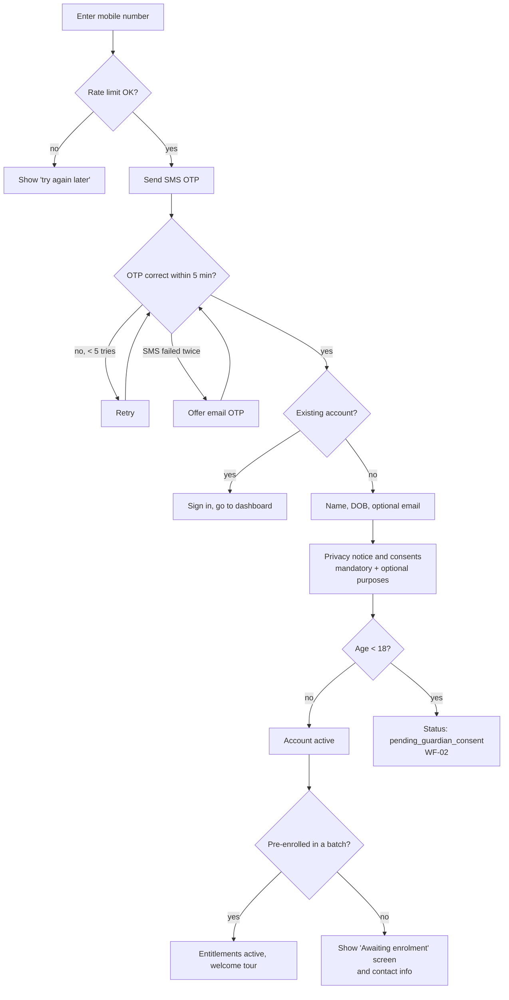
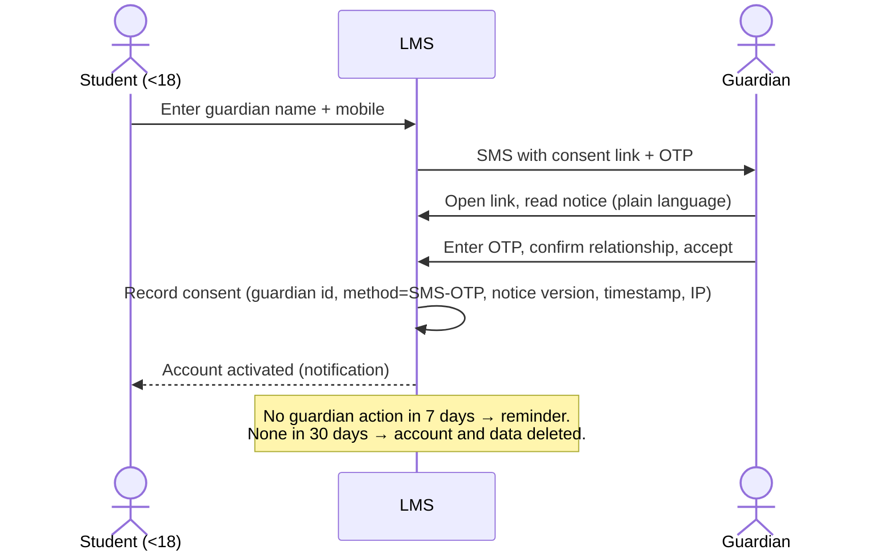
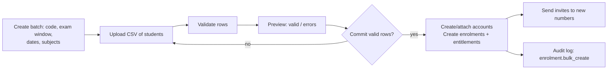
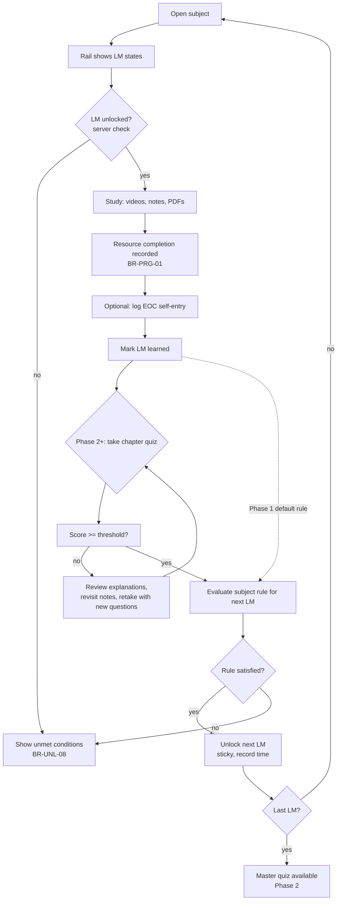
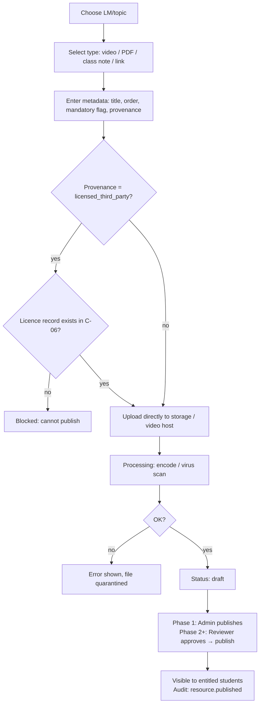
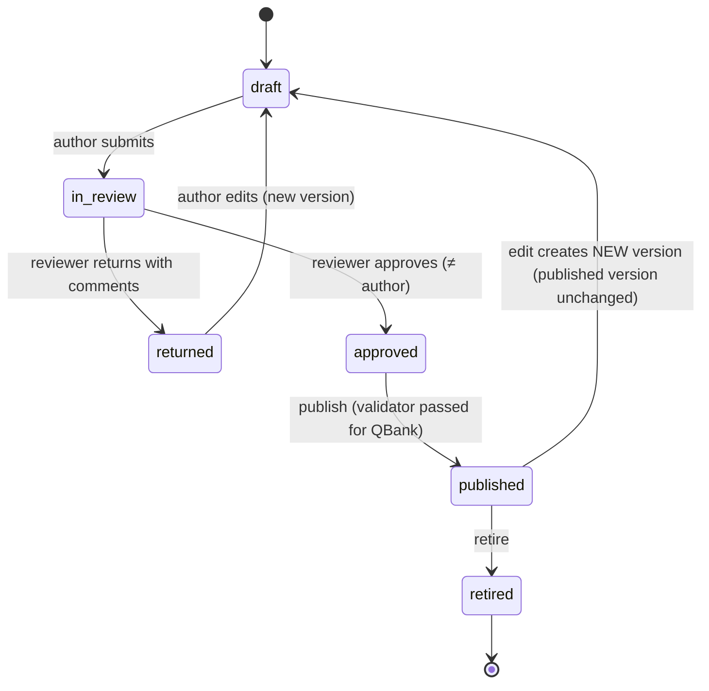
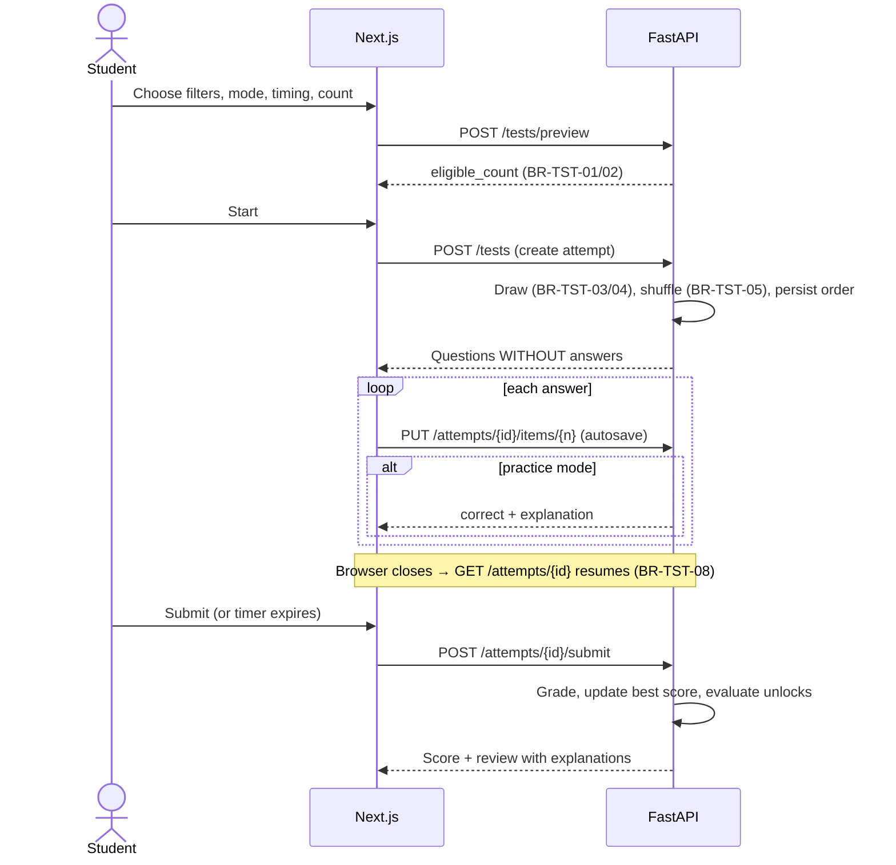
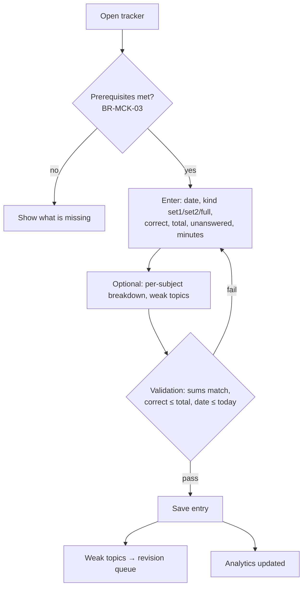
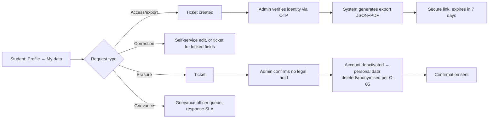

# P-05 User Workflow Specifications

| Field | Value |
|---|---|
| Document ID | P-05 |
| Version | 0.1 — Draft |
| Owner | Business analyst |
| Last updated | 2026-10-23 |
| Related | P-03 PRD, P-06 RBAC, P-09 Business rules, C-03 Consent |

Diagrams use Mermaid. They render in GitHub and in VS Code with a Mermaid preview extension.

---

## WF-01 Student sign-up and onboarding (Phase 1)

**Exceptions**
- A number already linked to a deactivated account shows "Contact support"; no new account is created.
- An unverified under-18 account is deleted after 30 days (C-05).

## WF-02 Verifiable parental consent (Phase 1)

A guardian can later withdraw consent through the link in their confirmation SMS or email. The student's account is then suspended and handled under C-05.

## WF-03 Batch creation and enrolment (Admin, Phase 1)

## WF-04 Study an LM and unlock the next (Phase 1 → Phase 2)

## WF-05 Resource upload and publish (Author/Admin, Phase 1)

## WF-06 Content and question review lifecycle (Phase 2–3)

**Review checklist** (completed by the reviewer before approving):
1. Original wording, with no copied source text (C-06).
2. Calculations recomputed.
3. Answer key matches the option text.
4. Distractors are plausible, with a rationale for each.
5. LOS mapping and command word are correct.
6. ₹ / Indian context is appropriate.
7. Formatting follows the style guide (P-08).

## WF-07 Custom test: build, attempt, resume, review (Phase 2)

## WF-08 EOC / Premium Pack / Mock self-entry (Phase 1 EOC, Phase 4 mocks)

## WF-09 Revision and flashcards (Phase 3)
1. The student opens the Revision tab for an LM. The revision sheet (2 pages) is shown and can be downloaded as a watermarked PDF.
2. "Start flashcards" shows the cards due for that LM, overdue cards first (BR-FC-04).
3. For each card: flip, then rate Known / Needs revision / Difficult. The next due date is computed (BR-FC-03).
4. A session of ≥ 10 cards logs one revision for the LM (BR-REV-04).

## WF-10 Data subject request (Phase 1)

## WF-11 Staff onboarding and offboarding (Phase 1)
- **Onboarding:** an admin creates the staff user (WF actor: super admin for admin roles) → an invite email is sent → first login sets the password and enrols TOTP → roles become active → audit event.
- **Offboarding:** deactivate → sessions revoked → drafts the person owns are reassigned → access review records the removal.

## WF-12 Unlock rule change (Admin, Phase 1)
1. The admin opens the rule editor for a subject → edits conditions → sees a plain-language preview.
2. Tests the rule against sample students → sees how many students would be affected.
3. Saves with a reason → a new rule version is created → audit event `unlock_rule.updated`.
4. The new rule applies to future evaluations. Existing unlocks stay (BR-UNL-06).

## WF-13 Contest (Phase 5)
Admin creates the contest (window, timer, question set, eligibility) → announcement → students register → reminders sent 24 hours and 1 hour before → the window opens and each student gets one attempt → grading on the server → admin reviews and publishes results → the leaderboard updates (opt-in names only).
