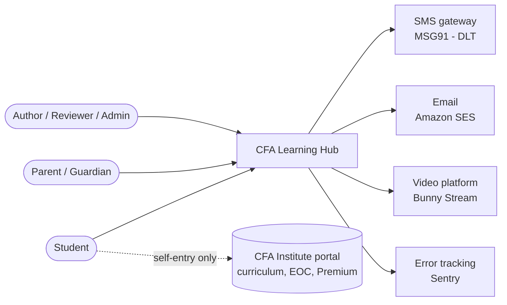
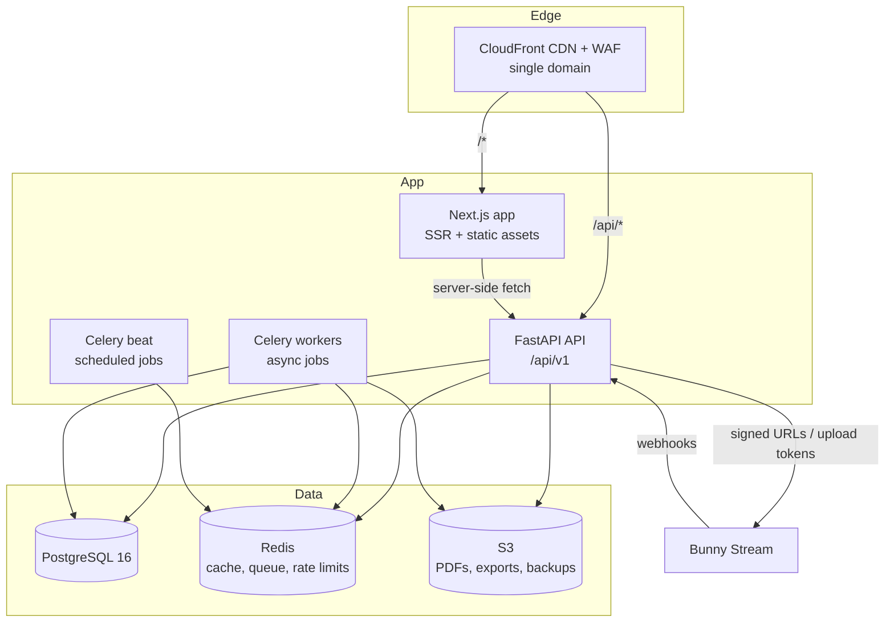
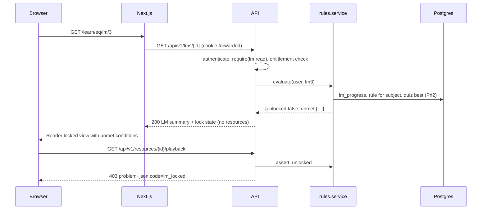

# A-01 Software Architecture Document

| Field | Value |
|---|---|
| Document ID | A-01 |
| Version | 0.1 — Draft |
| Owner | Solution architect / Tech lead |
| Last updated | 2026-10-23 |
| Related | A-02 ADRs, A-03 Data model, A-04 API, A-05 Infrastructure, S-01 Threat model, N-01 NFRs |

## 1. Goals and constraints

**Quality goals, in priority order:**
1. **Security and integrity:** access control on every request; no answer leakage; auditable content changes.
2. **Reliability of student data:** progress and test answers are never lost (autosave, transactions).
3. **Maintainability by a small team:** one deployable backend, clear module boundaries, typed contracts.
4. **Performance:** p95 under 2 s for common actions (N-01).
5. **Cost efficiency** at pilot scale (up to 2,000 active students).

**Constraints:**
- Next.js, FastAPI and PostgreSQL (D-001).
- Hosting in India.
- Licensed content is not hosted (D-004).
- DPDP compliance (C-01).

## 2. Architecture style
A **modular monolith** (ADR-002):
- One FastAPI application, split into domain modules with explicit interfaces.
- One PostgreSQL database with schema-per-module naming conventions.
- Background workers share the codebase.
- The Next.js frontend is a separate deployable.

This keeps operations simple for a small team, and modules can be extracted later if one scales differently.

## 3. System context (C4 level 1)



The CFA Institute portal is **not** integrated. Students study there and record their results in the LMS themselves.

## 4. Containers (C4 level 2)



| Container | Technology | Responsibility |
|---|---|---|
| Web | Next.js (App Router), TypeScript, React | Student and staff UI; server-side rendering of content pages; no business rules |
| API | Python 3.12, FastAPI, SQLAlchemy 2 (async), Pydantic v2 | All business logic, authorisation, grading, rule evaluation |
| Worker | Celery 5 + Redis broker | Imports, exports, virus scan, PDF watermarking, notifications, retention jobs, analytics rollups |
| Database | PostgreSQL 16 (RDS) | System of record; full-text search; JSONB content blocks |
| Cache / queue | Redis 7 (ElastiCache) | Celery broker, rate limiting, short-lived caches |
| Object storage | S3 (SSE-KMS) | PDFs, class notes, exports, backups |
| Video | Bunny Stream | Encoding, adaptive streaming, token-signed playback |

**Single-origin routing:** CloudFront serves `app.<domain>/` from Next.js and `app.<domain>/api/*` from FastAPI. Auth cookies are therefore first-party, with no CORS for the browser (ADR-003).

## 5. Backend modules (C4 level 3)

```
backend/app/
  core/          config, db session, security (JWT, hashing), errors, logging, request context, rbac, events
  modules/
    auth/        OTP, staff login + TOTP, sessions, refresh rotation
    users/       users, roles, guardians, profile
    privacy/     consents, notices, data requests (export/erase)
    enrolment/   batches, enrolments, entitlements
    catalog/     subjects, LMs, topics, LOS
    content/     content items + versions (notes blocks), renderer schema
    media/       resources, uploads, video (Bunny), PDF, scan, signed URLs
    progress/    resource progress, LM progress, revisions, EOC entries
    rules/       unlock rule storage + evaluator
    search/      FTS index maintenance + query
    bookmarks/
    audit/       audit writer, hash chain, viewer
    reports/     admin reports
    settings/    global settings, feature flags
    # Phase 2+
    qbank/  tests/  review/  exports/  revision/  flashcards/  mocks/  analytics/  engagement/
```

Each module contains `router.py` (HTTP), `service.py` (use cases), `repo.py` (data access), `models.py` (SQLAlchemy), `schemas.py` (Pydantic) and `events.py`.

**Module rules:**
- A module calls another module only through its `service` interface, never its `repo` or `models`. This is checked with `import-linter` contracts in CI.
- Cross-module side effects go through in-process **domain events**. Example: `progress.lm_learned` → rules re-evaluation → audit. Events that need async work are written to an **outbox table** in the same transaction and dispatched to Celery (at-least-once delivery, idempotent handlers).

## 6. Cross-cutting concerns

| Concern | Approach |
|---|---|
| Authentication | Students: SMS OTP. Staff: email + password (Argon2id) + TOTP. JWT access token (15 min, in memory / cookie) plus a rotating refresh token (httpOnly, Secure, SameSite=Lax, 30 days students / 12 h staff) with reuse detection (ADR-003). |
| Authorisation | `require(permission)` FastAPI dependency checks role permissions (P-06). Services also check entitlement and unlock (`rules.assert_unlocked(user, lm)`) and ownership. Deny by default. |
| Validation | Pydantic schemas on every input; strict types; maximum lengths; enums. |
| Rich content | Notes are stored as typed JSON blocks (A-03 §5), not HTML. Inline marks are limited to bold, italic, sub/superscript and link. The renderer escapes all text. |
| Errors | RFC 9457 problem+json with a `code`, `detail` and `request_id` (A-04). |
| Idempotency | `Idempotency-Key` header on POSTs that create things (enrolment import, test creation); keys stored for 24 h. |
| Transactions | One DB transaction per request (unit of work). The outbox is written in the same transaction. |
| Concurrency | Optimistic locking (`version` column) on editable admin entities. Progress updates use `INSERT … ON CONFLICT` with max/merge semantics. |
| Caching | Catalogue trees and published content versions are cached in Redis (5 min TTL plus invalidation on publish). User-specific data is not cached. |
| Logging and tracing | Structured JSON logs with `request_id`, `user_id` (pseudonymous) and `module`; OpenTelemetry traces; no PII in logs (D-05). |
| Audit | `audit.record(action, target, before, after)` is called from services for every event in G-01. The audit table is append-only with a hash chain. |
| Time | Stored in UTC (`timestamptz`); business-day logic uses the IST calendar (`Asia/Kolkata`). |
| Configuration | 12-factor environment variables via `pydantic-settings`; secrets from AWS Secrets Manager. |
| Feature flags | `settings.feature_flags` table, cached; used for phase rollouts and under-18 restrictions. |

## 7. Key runtime scenarios

### 7.1 Opening a locked LM



### 7.2 Secure video playback
1. The client requests `GET /resources/{id}/playback`.
2. The API checks entitlement and unlock, then returns a Bunny embed URL signed with a token and expiry (2 h), plus watermark text.
3. The player sends progress heartbeats to `POST /resources/{id}/progress` every 15 s, with the watched interval `[from_s, to_s]`.
4. The API merges intervals into `watched_ranges` (int4multirange). When coverage reaches ≥ 90%, it marks the resource complete (BR-PRG-01) and emits `progress.resource_completed`.

### 7.3 Upload
1. The author requests an upload. For video, the API creates the Bunny video and returns a TUS upload signature. For PDF, it returns an S3 presigned POST (size and type restricted).
2. The browser uploads directly.
3. The Bunny webhook (encoding finished) or the S3 event triggers a worker: virus scan (ClamAV) and metadata extraction. The resource becomes `draft` and ready to publish.

## 8. Frontend architecture
- **Next.js App Router.** Route groups: `(public)`, `(student)`, `(admin)`. Server components fetch from the API with the user's cookie forwarded. Interactive parts (player, quiz, editors) are client components.
- **API client:** generated from the FastAPI OpenAPI spec (`openapi-typescript` + `openapi-fetch`). TanStack Query for client-side caching and mutations.
- **Styling:** CSS custom-property tokens (P-07) with CSS Modules. Figtree via `next/font/local`.
- **Security:** strict Content Security Policy with nonces; no `dangerouslySetInnerHTML` except in the vetted block renderer (lint rule).
- **Middleware:** redirects unauthenticated users and does coarse role checks (cosmetic only; the API enforces).
- **i18n-ready:** strings are kept in message files (English first).

## 9. Data architecture
See A-03 for the full model. Key points:
- **UUIDv7** primary keys: time-ordered, so they index well.
- `created_at` and `updated_at` on every table; soft delete only where retention needs it.
- Versioned content (`*_versions` tables). Published versions are immutable, enforced by a trigger.
- Full-text search uses generated `tsvector` columns with GIN indexes. `pg_trgm` supports fuzzy title search and duplicate-stem detection (Phase 2).
- **Analytics events** go to a monthly-partitioned table. Heavy reports read from a **read replica** once one is provisioned (N-03).

## 10. Deployment view (summary)
The detail is in A-05. Each of web, api and worker is a container image on ECS Fargate across 2 AZs in ap-south-1, behind an ALB and CloudFront. The database is RDS PostgreSQL Multi-AZ. Infrastructure is defined in Terraform (D-04). Releases go through GitHub Actions (D-02).

## 11. Quality attribute scenarios

| ID | Scenario | Response | Measure |
|---|---|---|---|
| QA-1 | 300 students open the dashboard within 1 minute (batch start) | Cached catalogue; indexed progress queries | p95 < 1.5 s |
| QA-2 | A student's browser crashes mid-video | Last position is saved at most 15 s earlier | Resume within 15 s of where they stopped |
| QA-3 | A student calls the resource API for a locked LM | 403 with unmet conditions | 100% of locked requests denied (automated test) |
| QA-4 | An author's account is compromised | MFA blocks login; the audit trail shows actions; sessions can be revoked | Revocation within 1 minute |
| QA-5 | An AZ fails | Multi-AZ failover for RDS; ECS tasks in the other AZ | Recovery in under 5 minutes (RTO, D-06) |
| QA-6 | A new developer joins | `docker compose up` plus the seed script gives a working app | Running in under 1 hour (U-04) |

## 12. Repository layout (monorepo, ADR-011)

```
cfa-lms/
  frontend/            Next.js app
  backend/             FastAPI app, Alembic migrations, Celery tasks, tests
  infra/terraform/     modules + envs (staging, production)
  seed/                JSON extracted from the prototype
  .github/workflows/   CI/CD
  docker-compose.yml   local stack
  Documentation/       this documentation set
```

## 13. Technical debt and future evolution
- Extract `analytics` to a separate store (e.g. ClickHouse) if event volume exceeds ~50M rows per month.
- Add an AI module only after L-01..L-06; it reads approved content only, through the content service.
- Payments module once decision O-04 is made.
