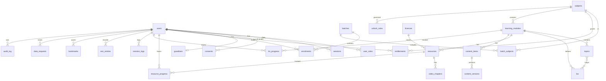

# A-03 Data Model, ERD & Data Dictionary

| Field | Value |
|---|---|
| Document ID | A-03 |
| Version | 0.1 — Phase 1 detailed; Phase 2+ outlined |
| Owner | Tech lead / DBA |
| Last updated | 2026-10-23 |
| Related | A-01, A-02 (ADR-007, ADR-012, ADR-013), C-04 Data inventory, C-05 Retention, G-01 Audit |

## 1. Conventions
- **Database:** PostgreSQL 16. Extensions: `citext`, `pg_trgm`, `btree_gist`.
- **Primary keys:** `id uuid` (UUIDv7, ADR-013), except the audit log and analytics events, which use `bigint`.
- **Standard columns:** `created_at timestamptz not null default now()` and `updated_at timestamptz not null`. `version int` (optimistic locking) on admin-editable tables.
- **Names:** snake_case and plural table names. Foreign keys are `<entity>_id`. Enums are PostgreSQL enum types prefixed by module (e.g. `user_status`).
- **Time:** stored in UTC. Day-based business logic uses `Asia/Kolkata`.
- **Deletes:** hard delete by default. Soft delete (`deleted_at`) only where the retention rules need tombstones (users).
- **Classification** (used in §6 and C-04):

| Code | Class | Examples |
|---|---|---|
| C0 | Public | Subject names |
| C1 | Internal | Unlock rules, `source_ref` |
| C2 | Confidential IP | Notes, answer keys, unpublished drafts |
| C3 | Personal | Name, email, mobile, progress |
| C4 | Personal: restricted | DOB, minor status, guardian data, auth secrets, IP addresses |

## 2. ERD — Phase 1



## 3. Data dictionary — Phase 1

### 3.1 Identity and access (module `users`, `auth`)

**users**

| Column | Type | Constraints | Class | Notes |
|---|---|---|---|---|
| id | uuid | PK | C1 | |
| mobile_e164 | text | unique, nullable for staff | C3 | `+91XXXXXXXXXX` |
| email | citext | unique, nullable | C3 | Required for staff |
| email_verified_at | timestamptz | | C3 | |
| full_name | text | not null, ≤ 120 | C3 | |
| dob | date | nullable for staff | C4 | Used only to determine minor status |
| is_minor | boolean | not null default false | C4 | Set at sign-up; re-evaluated on the 18th birthday by a daily job |
| status | user_status | `pending_guardian_consent`, `active`, `suspended`, `deactivated`, `deleted` | C1 | |
| password_hash | text | staff only | C4 | Argon2id |
| totp_secret_enc | bytea | staff only | C4 | Envelope-encrypted with KMS |
| mfa_enrolled_at | timestamptz | | C1 | |
| failed_login_count | int | default 0 | C1 | |
| locked_until | timestamptz | | C1 | |
| last_login_at | timestamptz | | C3 | |
| deleted_at | timestamptz | | C1 | Tombstone; personal columns are nulled when set |

**user_roles** — `user_id` FK, `role` (`student`, `author`, `reviewer`, `admin`, `super_admin`), `granted_by` FK users, `granted_at`. PK (`user_id`, `role`).

**guardians** — `id`, `student_user_id` FK unique, `full_name` (C4), `mobile_e164` (C4), `relationship` (parent, legal_guardian), `verified_at`, `verification_method` (`sms_otp`; later `digilocker`).

**sessions**

| Column | Type | Notes |
|---|---|---|
| id | uuid | PK |
| user_id | uuid | FK |
| family_id | uuid | Refresh-token rotation family |
| refresh_token_hash | bytea | SHA-256; unique |
| device_label | text | From user-agent parsing |
| ip_address | inet | C4; kept 180 days (C-05) |
| user_agent | text | |
| created_at, last_seen_at, expires_at | timestamptz | |
| revoked_at, revoke_reason | timestamptz, text | `logout`, `limit`, `reuse_detected`, `admin`, `deactivated` |

**otp_challenges** — `id`, `channel` (sms, email), `destination_hash` (HMAC of the number/email), `purpose` (signup, login, guardian_consent, data_request), `code_hash`, `attempts`, `expires_at`, `consumed_at`, `created_at`. Rows are purged after 24 h.

### 3.2 Privacy (module `privacy`)

**consents** — append-only. The current state is the latest row per (`user_id`, `purpose`).

| Column | Type | Notes |
|---|---|---|
| id | uuid | |
| user_id | uuid | FK |
| purpose | consent_purpose | `service_delivery`, `product_analytics`, `marketing_messages`, `leaderboard_display` |
| granted | boolean | |
| notice_version | text | e.g. `2026-11-v1` |
| actor | consent_actor | `self`, `guardian` |
| guardian_id | uuid | When actor = guardian |
| method | text | `checkbox`, `sms_otp` |
| ip_address | inet | C4 |
| user_agent | text | |
| created_at | timestamptz | |

**data_requests** — `id`, `user_id`, `type` (access, correction, erasure, grievance, consent_withdrawal), `status` (open, verifying, in_progress, completed, rejected), `due_at`, `handled_by`, `resolution_note`, `export_object_key`, `created_at`, `closed_at`.

### 3.3 Enrolment (module `enrolment`)

**batches** — `id`, `code` unique (e.g. `KSC-27`), `name`, `exam_window` (text, e.g. `2027-05`), `starts_on`, `ends_on` (check `ends_on >= starts_on`), `status` (planned, active, closed), `version`.

**batch_subjects** — PK (`batch_id`, `subject_id`).

**enrolments** — `id`, `user_id`, `batch_id`, `status` (active, paused, withdrawn, completed), `enrolled_by`, `enrolled_at`. Unique (`user_id`, `batch_id`).

**entitlements** — `id`, `user_id`, `subject_id`, `source` (batch, grant), `source_id`, `starts_at`, `ends_at`. Index (`user_id`, `subject_id`, `ends_at`). An entitlement is *active* when `now()` is between `starts_at` and `ends_at`.

### 3.4 Catalogue (module `catalog`)

**subjects** — `id`, `code` unique (`eth`, `qm`, `ec`, `cf`, `fsa`, `eq`, `fi`, `dv`, `ai`, `pm`), `name`, `icon`, `sort_order`, `status`, `unlock_mode` (gated, open), `settings jsonb` (e.g. `require_mandatory_before_learned`), `version`.

**learning_modules** — `id`, `subject_id`, `lm_no` (unique per subject), `title`, `summary`, `source_ref` (**C1 internal**, never in student APIs), `status` (draft, published, retired), `published_at`, `search_tsv` (generated), `version`.

**topics** — `id`, `lm_id`, `sort_order`, `title`, `status`.

**los** — `id`, `lm_id`, `code` (e.g. `EQ-1-a`), `statement`, `command_word` (enum list maintained by the academic lead). Unique (`lm_id`, `code`).

**topic_los** — PK (`topic_id`, `los_id`).

### 3.5 Content and media (modules `content`, `media`)

**content_items** — `id`, `lm_id`, `topic_id` nullable, `kind` (note, revision_sheet, infographic, game), `sort_order`, `current_published_version_id`.

**content_versions**

| Column | Type | Notes |
|---|---|---|
| id | uuid | |
| item_id | uuid | FK |
| version_no | int | Unique per item |
| body | jsonb | Block document (§5), validated by a JSON Schema |
| status | content_status | draft, in_review, returned, approved, published, retired |
| provenance | provenance | original, faculty_recording, licensed_third_party, reference_only |
| licence_id | uuid | Required if `licensed_third_party` |
| author_id, reviewer_id | uuid | `reviewer_id ≠ author_id` (check + SoD) |
| review_comment | text | |
| search_tsv | tsvector | Generated from the block text |
| created_at, submitted_at, approved_at, published_at | timestamptz | |

A trigger blocks UPDATE on rows where `status in ('approved','published')`, except the status move to `retired`.

**resources**

| Column | Type | Notes |
|---|---|---|
| id | uuid | |
| lm_id, topic_id | uuid | `topic_id` nullable |
| kind | resource_kind | video, pdf, class_note, link |
| title | text | |
| sort_order | int | |
| mandatory | boolean | BR-PRG-02 |
| downloadable | boolean | PDFs only |
| provenance, licence_id | | As above |
| status | resource_status | uploading, processing, draft, published, retired, failed |
| video_guid | text | Bunny video ID |
| storage_key | text | S3 key for PDFs |
| url | text | For links; https only |
| duration_s | int | |
| page_count | int | |
| size_bytes | bigint | |
| sha256 | bytea | |
| scan_status | scan_status | pending, clean, infected, error |
| created_by | uuid | |
| published_at | timestamptz | |

**video_chapters** — `resource_id`, `start_s`, `title`, `topic_id`. PK (`resource_id`, `start_s`).

**licences** — `id`, `licensor`, `title`, `scope` (text), `permitted_uses` (text[]), `valid_from`, `valid_to`, `document_key` (S3), `recorded_by`. Mirrors the C-06 register.

### 3.6 Progress (module `progress`)

**resource_progress** — PK (`user_id`, `resource_id`).

| Column | Type | Notes |
|---|---|---|
| watched_ranges | int4multirange | Unique seconds watched (videos) |
| last_position_s | int | |
| max_page_seen | int | PDFs |
| completed_at | timestamptz | Set once; never cleared |
| updated_at | timestamptz | |

**lm_progress** — PK (`user_id`, `lm_id`): `unlocked_at`, `unlock_source` (first, rule, manual, open_mode), `unlocked_by` (admin, for manual), `unlock_reason`, `learned_at`, `learned_undo_until`.

**revision_logs** — `id`, `user_id`, `lm_id`, `revised_on` (date, IST), `activity` (notes, revision_sheet, flashcards, questions, other), `counted` (bool; one per user, LM and day), `source` (manual, auto), `created_at`. Partial unique index on (`user_id`, `lm_id`, `revised_on`) WHERE `counted`.

**eoc_entries** — PK (`user_id`, `lm_id`): `attempted` bool, `q_attempted` int, `q_correct` int (check `q_correct <= q_attempted`), `completed_on` date (≤ today), `weak_topic_ids` uuid[], `updated_at`.

**bookmarks** — `id`, `user_id`, `target_type` (topic, resource, content_item), `target_id`, `position_s`, `note` (≤ 500), `created_at`. Unique (`user_id`, `target_type`, `target_id`, `position_s`).

### 3.7 Rules, settings, audit

**unlock_rules** — `id`, `subject_id`, `lm_id` (nullable; set for an override), `version_no`, `rule` jsonb (validated by schema), `active` bool, `reason`, `created_by`, `created_at`. Partial unique index: one active rule per (`subject_id`, `lm_id`).

**settings** — `key` PK, `value` jsonb, `updated_by`, `updated_at`. Holds feature flags, retention periods and auth policy.

**audit_log** — see G-01 §4 for fields. `bigint` identity PK, `prev_hash`, `hash`. Append-only: INSERT is granted to the application role; UPDATE and DELETE are revoked.

**outbox** — `id` bigint, `topic`, `payload` jsonb, `created_at`, `dispatched_at`, `attempts`.

**analytics_events** — `id` bigint, `occurred_at`, `pseudo_user_id` (HMAC of user ID), `session_id`, `name`, `props` jsonb. Partitioned monthly (Q-05).

**idempotency_keys** — `key`, `user_id`, `request_hash`, `response` jsonb, `created_at`. Purged after 24 h.

## 4. Key indexes (Phase 1)
- `entitlements (user_id, subject_id) WHERE ends_at > now()`. Not usable as a partial index with `now()`, so use (`user_id`, `subject_id`, `ends_at`).
- `learning_modules (subject_id, lm_no)` unique.
- `resource_progress (user_id) INCLUDE (completed_at)`.
- `lm_progress (user_id)`.
- `content_versions USING gin (search_tsv)`; `learning_modules USING gin (search_tsv)`; `los USING gin (to_tsvector('english', statement))`.
- `audit_log (occurred_at)`, `(actor_user_id, occurred_at)`, `(target_type, target_id)`.
- `sessions (user_id) WHERE revoked_at IS NULL`.

## 5. Content block schema (ADR-012)

```json
{
  "schema": "notes/v1",
  "blocks": [
    {"type": "heading", "level": 3, "text": "The liquidation waterfall"},
    {"type": "paragraph", "inline": [{"t": "Loss is capped at the amount invested. This is "}, {"t": "limited liability", "b": true}, {"t": "."}]},
    {"type": "list", "ordered": false, "items": [[{"t": "Ownership may carry voting rights."}]]},
    {"type": "table", "header": ["Feature", "What it means", "Who benefits"], "rows": [["Cumulative", "Missed dividends build up", "Holder"]]},
    {"type": "callout", "variant": "example", "title": "Worked example", "inline": [{"t": "Aditya Foods is liquidated..."}]},
    {"type": "callout", "variant": "watch_out", "title": "Watch out", "inline": [{"t": "..."}]},
    {"type": "callout", "variant": "formula", "title": "Formula", "inline": [{"t": "Annual preference dividend = rate × par × shares"}]},
    {"type": "callout", "variant": "fun", "title": "Funny use case", "inline": [{"t": "Think of a wedding buffet..."}]},
    {"type": "infographic", "kind": "waterfall", "data": [{"label": "1st · Debt", "text": "Debt holders", "pct": 100}], "alt": "Priority of claims: debt, then preferred, then common"},
    {"type": "image", "asset_id": "uuid", "alt": "required", "caption": ""}
  ]
}
```

Inline marks: `b`, `i`, `sub`, `sup`, `link` (https only, plus allow-listed domains). `alt` is required on images and infographics. The schema is enforced with JSON Schema in the API (`backend/app/modules/content/schema/notes_v1.json`).

## 6. Phase 2+ entities (outline)

| Module | Tables |
|---|---|
| qbank | `questions` (id, lm_id, current_published_version_id), `question_versions` (stem blocks, options[3] jsonb, correct_index, worked_solution blocks, distractor_rationale[3], difficulty E/M/H, qtype conceptual/numerical, calc_mechanic, los_id, command_word, lock_option_order, recompute_expr, provenance, status, author_id, reviewer_id), `question_stats` (attempts, correct, p_value, discrimination, avg_time_s, last_computed_at), `validation_runs` |
| review | `review_tasks` (target_type, target_version_id, assignee, status, due_at), `review_comments` |
| tests | `test_templates` (owner, filters jsonb, mode, timed, count), `test_attempts` (user, template/kind chapter/master/custom/contest, mode, timed, time_limit_s, started_at, submitted_at, score_pct, status), `attempt_items` (attempt_id, position, question_version_id, option_order int[], answer_index, answered_at, time_spent_s, is_correct) |
| revision | `flashcards`, `flashcard_versions`, `card_reviews` (user, card, rating, ease, interval_d, due_on), `revision_queue` |
| mocks | `mock_entries` (user, mock_no, kind set1/set2/full, taken_on, total, correct, unanswered, minutes, subject_breakdown jsonb, weak_topic_ids), `premium_pack_progress` |
| engagement | `xp_events` (idempotency_key unique), `badges`, `user_badges`, `contests`, `contest_registrations`, `announcements`, `certificates` (public verify code) |

## 7. Seed mapping from the prototype

| Prototype constant | Target |
|---|---|
| `SUBJ` | `subjects` + `learning_modules` (10 subjects, 56 LMs) |
| `AUTH['eq:0'..'eq:2']` | `topics` + `content_items`/`content_versions` (HTML converted to blocks by a script; provenance `original`, status `published`) |
| `AUTH[*].vids` | Not imported (they are placeholders); the titles become a checklist for real uploads |
| `BANK` (61 questions) | Phase 2: `questions` + `question_versions` (status `approved`; LOS left blank for back-fill) |
| `CARDS` | Phase 3: `flashcards` |
| `CONTESTS`, `NEWS`, `LB`, `BADGES` | Phase 5 fixtures (demo only) |
