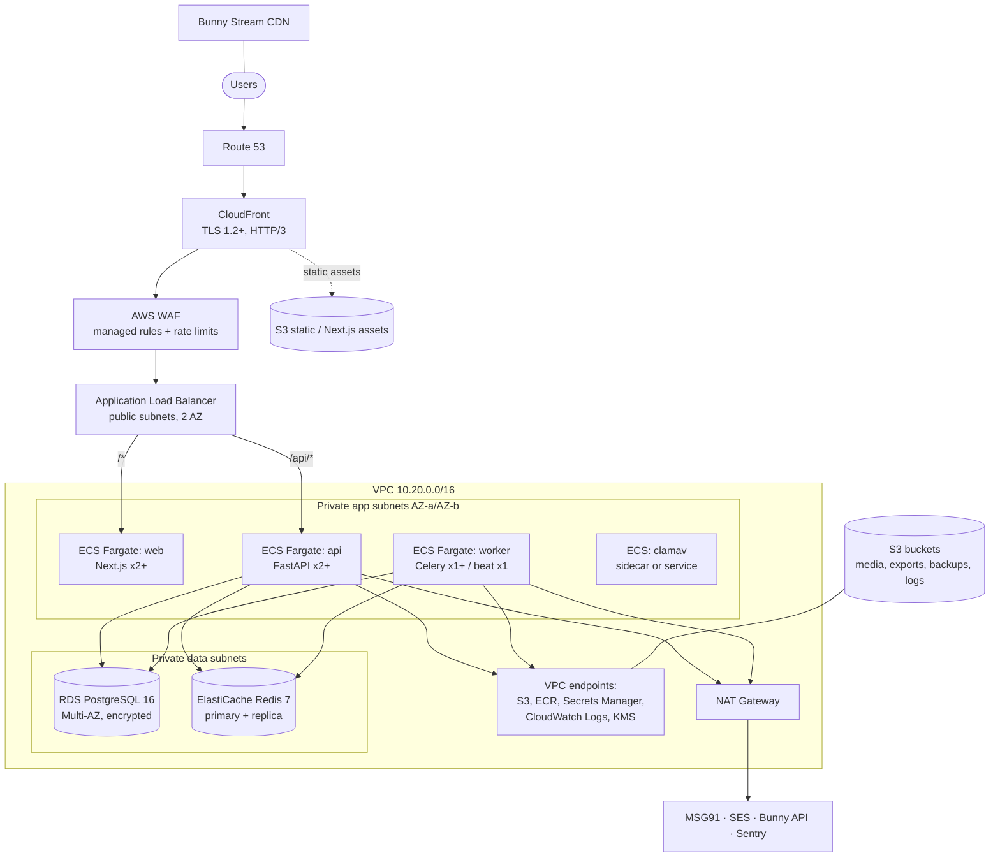

# A-05 Infrastructure Architecture

| Field | Value |
|---|---|
| Document ID | A-05 |
| Version | 0.1 — Proposed (pending O-07 / ADR-006) |
| Owner | Cloud architect / DevOps |
| Last updated | 2026-10-23 |
| Related | A-01, ADR-005/006, D-01..D-06, N-01, N-03, M-02 §4 |

## 1. Principles
- Data at rest stays in India. The primary region is **AWS ap-south-1 (Mumbai)**; the DR backup copy is in **ap-south-2 (Hyderabad)**.
- Use managed services over self-managed ones, for a small team.
- Everything is defined in Terraform (D-04). No console changes in production.
- Least privilege; private subnets for compute and data; no SSH (ECS Exec, audited, for emergencies only).
- Staging and production use the same architecture, with smaller sizes in staging.

## 2. Topology

Routing is defined in CloudFront behaviours: `/_next/static/*` goes to S3 (immutable, cached for 1 year); `/api/*` goes to the ALB with no caching, all headers and cookies forwarded; the default route goes to the ALB (Next.js). The ALB only accepts traffic from the CloudFront managed prefix list plus a secret origin header.

## 3. Components and sizing

| Component | Production (pilot) | Staging | Scaling |
|---|---|---|---|
| ECS web (Next.js) | 2 tasks × 0.5 vCPU / 1 GB | 1 task | Target-tracking on CPU 60%, max 6 |
| ECS api (FastAPI, uvicorn workers=2) | 2 tasks × 1 vCPU / 2 GB | 1 task | CPU 60% and ALB requests per target; max 8 |
| ECS worker (Celery) | 1 task × 1 vCPU / 2 GB (+ beat 0.25 vCPU) | 1 task | Queue depth (custom metric); max 4 |
| ClamAV | 1 task × 0.5 vCPU / 2 GB | shared | — |
| RDS PostgreSQL 16 | db.t4g.medium Multi-AZ, gp3 100 GB, PITR 14 days | db.t4g.small single-AZ, PITR 3 days | Vertical; read replica when CPU > 60% sustained (N-03) |
| ElastiCache Redis 7 | cache.t4g.small primary + replica, AOF on | cache.t4g.micro | Vertical |
| S3 | `media-prod`, `exports-prod`, `backups-prod`, `logs-prod` | `*-staging` | — |
| Bunny Stream | Separate library per environment | — | Managed |

Production is sized for **up to 2,000 active students and 300 concurrent** users. It is re-validated by the load test (N-04).

## 4. Network
- VPC `/16`: 2 public subnets (ALB, NAT), 2 private app subnets, 2 private data subnets across 2 AZs.
- **Security groups:**
  - `alb-sg`: 443 from the CloudFront prefix list only.
  - `app-sg`: from `alb-sg` only.
  - `data-sg`: 5432 and 6379 from `app-sg` only.
- **Egress:** through NAT to allow-listed SaaS endpoints. VPC endpoints for AWS services reduce NAT traffic.
- **NAT:** one NAT gateway in production (cost trade-off; accepted risk: an AZ outage affects outbound SMS/email until failover). Upgrade to 2 NAT gateways when revenue justifies it.

## 5. Security controls in the infrastructure
- **Encryption:**
  - TLS 1.2+ at CloudFront and the ALB (ACM certificates).
  - RDS, ElastiCache, S3 and EBS encrypted with customer-managed KMS keys (separate keys per data class: `db`, `media`, `backups`).
  - Redis with in-transit encryption and AUTH.
- **Secrets:** AWS Secrets Manager (DB credentials rotated every 30 days, JWT signing keys, Bunny/MSG91 API keys), injected into ECS task definitions as secrets.
- **IAM:**
  - Task roles scoped per service (e.g. only the worker can write to the `exports` bucket).
  - GitHub Actions deploys through OIDC with no long-lived keys.
  - Humans use IAM Identity Center with MFA; production access is time-bound.
- **WAF:** AWS managed rule sets (Common, KnownBadInputs, SQLi, IP reputation), rate rules on `/api/v1/auth/*`, and geo-blocking review (allow India plus the countries where students actually are).
- **S3:** Block Public Access on; bucket policies require TLS; media objects are only reached through presigned URLs; the `backups` bucket uses Object Lock (compliance mode, 35 days).
- **Logging:**
  - CloudTrail (organisation trail) and VPC Flow Logs (rejects).
  - ALB and CloudFront access logs go to `logs-prod`, retained for 180 days to meet CERT-In (C-05).
- **Detection:** GuardDuty, Security Hub (CIS AWS benchmark), AWS Config rules.
- **Patching:** Fargate (no hosts to patch). Base images are rebuilt weekly and scanned with ECR enhanced scanning and Trivy (S-03).

## 6. Environments
See D-01. Each environment is a separate **AWS account** under AWS Organizations (`shared`, `staging`, `production`), with SCPs that deny leaving the approved regions and deny disabling CloudTrail or GuardDuty.

## 7. Backup and DR (summary; full plan in D-06)
- RDS automated backups with PITR (14 days); daily snapshots copied to ap-south-2.
- S3 versioning plus cross-region replication for `media` (PDFs) and `backups`.
- Bunny Stream holds the master video files. The original uploads are also archived in S3 Glacier Instant Retrieval (ap-south-1), so the videos can be rebuilt if the vendor fails.
- Targets: **RPO ≤ 15 minutes, RTO ≤ 4 hours** for regional failure. Within a region (AZ failure): RTO ≤ 5 minutes.

## 8. Observability (summary; full spec in D-05)
- CloudWatch Logs (JSON) with 30-day hot retention, exported to S3 for longer retention.
- CloudWatch metrics and Container Insights; Sentry for application errors (frontend and backend).
- OpenTelemetry traces exported to AWS X-Ray (or Grafana Cloud, if chosen later).
- Synthetic checks: CloudWatch Synthetics canary runs sign-in, opens a subject and plays a video every 5 minutes.

## 9. Local development
`docker-compose.yml` runs `postgres:16`, `redis:7`, `api` (hot reload), `worker`, `web` (Next dev) and `mailpit` (captures email). Bunny and SMS are replaced by fakes (`VIDEO_PROVIDER=fake`, `SMS_PROVIDER=console`). See U-04.

## 10. Cost
See M-02 §4.1 for the indicative monthly range (≈ USD 525–925 for production plus staging at pilot scale). Tagging (`project`, `env`, `service`, `owner`) is mandatory, so AWS Cost Explorer can break down cost. A budget alert is set at 80% and 100% of the monthly forecast.
