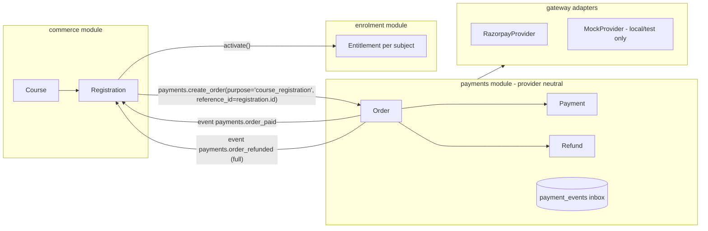
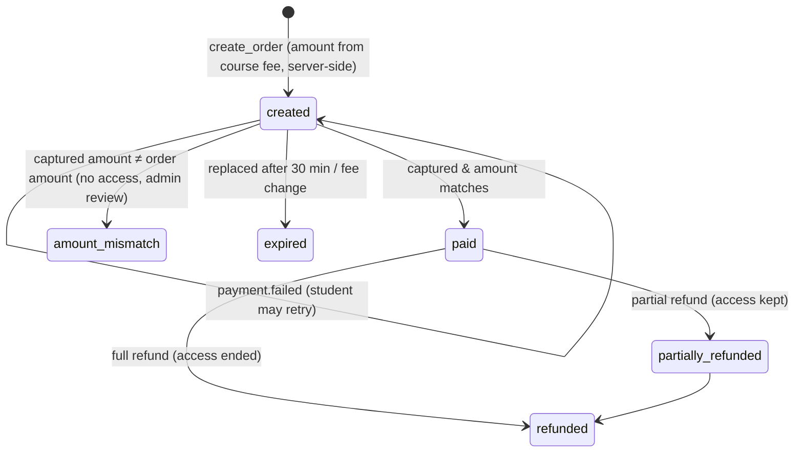

# A-08 Payments & Registration Integration Spec

| Field | Value |
|---|---|
| Document ID | A-08 |
| Version | 0.1 — matches the implemented code |
| Owner | Tech lead |
| Last updated | 2026-10-23 |
| Related | P-09 §12 (BR-PAY), D-010, A-04, S-01 |

## 1. Goals
- Students register for a **course** and pay the fee online. Razorpay comes first.
- The payment code knows nothing about courses, so:
  - other gateways (PayU, Cashfree, Stripe) can be added without touching the learning code;
  - the payments module can later be split into its own service, or built by a separate team.
- Payment is confirmed only on the server (BR-PAY-04). Webhooks are idempotent (BR-PAY-05).

## 2. Module boundaries

- `commerce` calls only `payments.service.create_order / open_order_for / record_offline`.
- `payments` reports outcomes only through **events** (§6). It never imports `commerce`.
- Source: `backend/app/modules/payments/` and `backend/app/modules/commerce/`.

## 3. Gateway port
`backend/app/modules/payments/providers/base.py` defines `PaymentProvider`:

| Method | Purpose |
|---|---|
| `create_order(intent) → ProviderOrder` | Create the gateway order; return the browser checkout parameters |
| `verify_checkout(payload) → (order_id, payment_id)` | Verify the browser success callback signature |
| `fetch_payment(id) → PaymentInfo` | Server-side truth for a payment |
| `capture(id, amount, currency)` | Capture an authorised payment |
| `verify_webhook(headers, body) → bool` | HMAC check of the raw body |
| `parse_webhook(headers, body) → GatewayEvent` | Normalise to `payment.captured`, `payment.failed`, `refund.processed` or `ignored` |
| `refund(id, amount, notes) → RefundInfo` | Full or partial refund |

**To add a gateway:**
1. Implement the protocol.
2. Register it in `providers/__init__.py`.
3. Add a `/payments/webhooks/{name}` literal to the router.
4. Add its settings to `core/config.py`.

## 4. Order lifecycle

**Confirmation paths.** Both are idempotent, and whichever arrives first wins:
1. **Webhook:** `POST /api/v1/payments/webhooks/razorpay`.
   - Signature verified, then stored in `payment_events` with a unique `(provider, event_id)`.
   - Processed once; replays return `duplicate`.
2. **Browser callback:** `POST /api/v1/payments/orders/{id}/confirm` with the Razorpay handler payload.
   - Signature verified, then `fetch_payment()` from the gateway, then applied.

## 5. Razorpay setup (when going live)
1. Create a Razorpay account and complete KYC. Use **Test mode** keys first.
2. Set the environment variables:
   - `PAYMENT_PROVIDER=razorpay`
   - `RAZORPAY_KEY_ID`, `RAZORPAY_KEY_SECRET`
   - `RAZORPAY_WEBHOOK_SECRET`
3. Dashboard → Webhooks:
   - URL `https://<domain>/api/v1/payments/webhooks/razorpay`
   - Events: `payment.captured`, `payment.failed`, `order.paid`, `refund.processed`
   - Secret = `RAZORPAY_WEBHOOK_SECRET`
4. Enable automatic capture (payment capture settings). The code also captures `authorized` payments itself.
5. **Local webhook testing:** expose port 8000 with a tunnel (e.g. `cloudflared tunnel --url http://localhost:8000`) and register the tunnel URL in test mode.
6. **Frontend:** nothing to change. The register page loads `checkout.js` and opens Standard Checkout with the options the API returns.

## 6. Domain event contract (for other services and teams)
Events are written to the `outbox` table in the same transaction as the change.
- If `EVENT_SINK_URL` is set, the dispatcher POSTs each event as JSON:
  - body: `{id, topic, payload, created_at}`
  - header: `X-Event-Signature: HMAC_SHA256(body, SECRET_KEY)`
  - delivery is at least once and retried, so consumers must be idempotent on `id`.

| Topic | Payload |
|---|---|
| `payments.order_paid` | `order_id, number, user_id, purpose, reference_id, amount_paise, provider` |
| `payments.payment_failed` | same + `error` |
| `payments.order_refunded` | same + `refund_paise, full` |

A separately deployed payments service would publish the same topics, and `commerce` would subscribe through the sink instead of in-process. The registration logic does not change.

## 7. Local development: the mock gateway
- `PAYMENT_PROVIDER=mock` (default in local/test). The provider refuses to load in any other environment.
- After registration the student is redirected to `/mock-gateway`, which offers "Pay (success)" or "Simulate a declined payment".
- The mock signs a webhook exactly like Razorpay (HMAC) and delivers it to the real webhook handler. The whole flow, including idempotency, runs without real money.

## 8. Admin operations
- **Offline payment** (cash or bank transfer): Registrations → Record an offline payment. This creates an order with provider `offline` and status `paid`.
- **Refund:** Payments → order → Issue a refund. A full refund cancels the registration and revokes its entitlements (BR-PAY-08).
- **Amount mismatch:** the overview shows "Orders needing review". Check the payment in the gateway dashboard and resolve it by refunding or recording it offline.

## 9. Not yet built
- GST invoices (needs GSTIN, invoice numbering and an HSN/SAC code).
- Coupons and discounts.
- EMI options.
- Automatic expiry job for stale `created` orders (today they are expired lazily when a new checkout starts).
