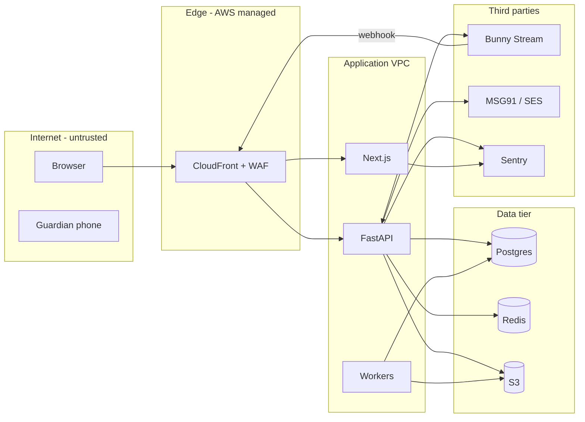

# S-01 Security Architecture & Threat Model

| Field | Value |
|---|---|
| Document ID | S-01 |
| Version | 0.1 — Phase 1 scope (Phase 2 test engine included) |
| Owner | Security lead |
| Last updated | 2026-10-23 |
| Method | STRIDE per element and trust boundary, plus product-specific abuse cases |
| Related | A-01, A-05, P-06, S-02, S-03, S-04 |

## 1. Assets

| ID | Asset | Class | Why it matters |
|---|---|---|---|
| AS-1 | Student personal data (mobile, DOB, minor status, guardian data) | C3/C4 | DPDP obligations; harm to students |
| AS-2 | Authentication secrets (password hashes, TOTP secrets, refresh tokens, JWT keys) | C4 | Account takeover |
| AS-3 | Proprietary content (videos, notes, revision sheets) | C2 | Core business IP; piracy |
| AS-4 | Question bank with answer keys (Phase 2) | C2 | Test integrity |
| AS-5 | Progress, scores, attempts | C3 | Integrity of unlocks and certificates |
| AS-6 | Audit log | C1 | Accountability, forensics |
| AS-7 | Admin capabilities (roles, rules, publishing) | — | Abuse means a platform-wide impact |
| AS-8 | Availability during exam season and contests | — | Reputation |

## 2. Actors
- **Legitimate:** student, guardian, author, reviewer, admin, super admin, operators.
- **Threat actors:**
  - TA-1: curious or cheating student (authenticated).
  - TA-2: account sharer or reseller (authenticated, piracy).
  - TA-3: external attacker (unauthenticated; credential stuffing, SMS pumping, scanning).
  - TA-4: compromised staff account.
  - TA-5: malicious insider.
  - TA-6: compromised third party (SaaS or dependency).

## 3. Trust boundaries

Boundary crossings that need controls:
1. Browser → Edge.
2. Edge → App.
3. App → Data.
4. App → third parties.
5. Third-party webhooks → App.
6. Staff console → admin APIs (privileged).

## 4. STRIDE analysis

| ID | Element / flow | STRIDE | Threat | Mitigation | Residual |
|---|---|---|---|---|---|
| T-01 | Login (OTP) | S | Brute-forcing the OTP | 6 digits, 5-minute TTL, 5 attempts per challenge, per-IP and per-destination limits, WAF rate rules | Low |
| T-02 | OTP request | D / financial | **SMS pumping** (sending OTPs to premium numbers to run up SMS cost) | Indian numbers only (+91) by default; per-destination and per-IP limits; CAPTCHA (Cloudflare Turnstile / hCaptcha) after 2 requests; daily SMS spend alarm | Low |
| T-03 | Staff login | S | Credential stuffing or phishing of staff | Argon2id, breached-password check, mandatory TOTP, lockout, login alert email on new device | Low |
| T-04 | Session cookies | S / I | Token theft through XSS; CSRF | httpOnly cookies; strict CSP with nonces; SameSite=Lax plus a CSRF token; short access TTL; refresh rotation with reuse detection | Low |
| T-05 | API resources | E / I | **IDOR**: reading other users' progress or data by changing IDs | Ownership checks in services; UUIDv7; automated tests per endpoint ("user B cannot read A"); 404 for invisible items | Low |
| T-06 | Locked content | E | Calling resource/content APIs directly to skip unlock rules | `assert_unlocked` in every content/resource service; contract tests (QA-3) | Low |
| T-07 | Notes rendering | T / E | **Stored XSS** through author-supplied content | JSON block schema (ADR-012); no raw HTML; links https plus allow-list; CSP; lint rule bans `dangerouslySetInnerHTML` outside the renderer | Low |
| T-08 | File uploads | T / E | Malware or polyglot files in PDFs; oversized files | Presigned POST with content-type and size limits; ClamAV scan before availability; PDF re-rendered through `qpdf --linearize`; files served from a separate domain/bucket via presigned URLs with `Content-Disposition` | Low |
| T-09 | Video | I | **Piracy**: sharing links, downloading streams, screen recording | Token-signed URLs (2 h); referrer restriction; per-user moving watermark; session limits; anomaly report (more than 3 devices or more than 8 hours of playback per day); DRM later if needed | Medium (screen recording can't be fully prevented) |
| T-10 | PDFs | I | Redistribution of notes | Watermark with the student's name and ID on download; download only where allowed | Medium |
| T-11 | Test engine (Ph2) | I / T | **Answer-key leakage**; tampering with scores; replaying submissions | ADR-010 server grading; no keys in the payload; option-order mapping kept on the server; one submission per attempt (state machine); time limit enforced on the server | Low |
| T-12 | Admin APIs | E | A compromised staff account changes roles or publishes malicious content | MFA; SoD (P-06 §4); audit plus alerts on role changes; re-authentication (step-up TOTP) for role changes, rule changes and exports | Low |
| T-13 | Audit log | R / T | Actions denied, or logs altered | Append-only table (no UPDATE/DELETE grants), hash chain, daily anchor of the latest hash to S3 Object Lock | Low |
| T-14 | Webhooks | S | Forged Bunny webhooks marking videos as ready | HMAC signature check plus timestamp tolerance; resource state re-checked through the Bunny API | Low |
| T-15 | Database | I | SQL injection | SQLAlchemy parameterised queries; no string-built SQL (Semgrep rule); least-privilege DB roles (app, migrator, readonly) | Low |
| T-16 | Secrets | I | Leaked API keys or DB credentials | Secrets Manager; gitleaks in CI and pre-commit; rotation | Low |
| T-17 | Dependencies | T | Supply-chain compromise (npm/PyPI) | Lockfiles; Dependabot; `pip-audit` / `npm audit`; pinned base images; minimal dependencies; SBOM (Syft) per build | Medium |
| T-18 | Availability | D | Traffic floods; expensive queries (search) | CloudFront/WAF, rate limits, query timeouts (`statement_timeout` 5 s for API), pagination limits, autoscaling | Low |
| T-19 | Data export (DPDP) | I | Export link sent to the wrong person | Identity re-verified by OTP; presigned link valid 7 days; download logged | Low |
| T-20 | Guardian consent | S | A student fakes guardian consent using a second phone | OTP to a different number than the student's; capture relationship; spot checks; consider DigiLocker-based verification (C-03 §5) | Medium (accepted; legal review O-11) |
| T-21 | Third-party SaaS | I | Sentry or logs receiving PII | Scrub PII before sending (Sentry `before_send`); no request bodies in logs; DPAs (C-07) | Low |
| T-22 | Insider | I / T | An admin exports data in bulk | Exports audit-logged, alert on more than 1,000 rows, quarterly access review, break-glass controls | Low |

## 5. Abuse cases specific to the product

| ID | Abuse case | Control |
|---|---|---|
| AB-1 | A student shares the account with friends to split the fee | 2-device session limit; OTP on a new device; concurrent-playback detection; ToS clause |
| AB-2 | A student scripts the progress API to mark videos complete without watching | Server checks: heartbeat intervals must be ≤ 30 s, contiguous with playback, and rate-limited; coverage counts unique seconds; anomalies flagged |
| AB-3 | A student creates a new account to retake a contest (Ph5) | One account per mobile number; contest eligibility tied to enrolment |
| AB-4 | An author copies third-party questions into the QBank | Reviewer originality check; similarity check against an internal corpus; provenance required (C-06) |
| AB-5 | A student brute-forces practice mode to harvest answer keys | Practice mode shows answers by design, so keys are not secret in practice mode. Contest and assessment question pools are kept separate from practice pools [config]. |

## 6. Security architecture controls summary

| Layer | Controls |
|---|---|
| Edge | CloudFront, WAF managed rules, rate limiting, TLS 1.2+, HSTS preload, bot control (optional) |
| Web | CSP (nonce-based; `default-src 'self'`; `frame-src` Bunny only), `X-Frame-Options DENY`, `Referrer-Policy strict-origin-when-cross-origin`, `Permissions-Policy` |
| API | AuthN, RBAC, entitlement and unlock checks, Pydantic validation, rate limiting, problem+json without stack traces, request IDs |
| Data | Encryption with KMS, separate DB roles, row ownership checks, backups with Object Lock |
| Ops | Least-privilege IAM, SSO with MFA, audit trails (CloudTrail + app audit), GuardDuty, vulnerability scanning |

## 7. Security testing
- **Every PR:** SAST (Semgrep, Bandit), dependency audit, secrets scan (S-03).
- **Nightly on staging:** OWASP ZAP baseline scan.
- **Authorisation test matrix:** automated tests for each role × endpoint, plus cross-user IDOR tests.
- **External penetration test** before the Phase 1 go-live and before Phase 2 (test engine). Findings are tracked in S-05.

## 8. Review
The threat model is updated at each phase start, and whenever a new external integration or data class is added.
