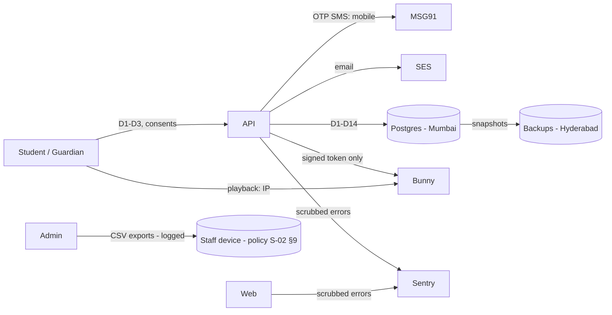

# C-04 Data Inventory & Classification (Record of Processing)

| Field | Value |
|---|---|
| Document ID | C-04 |
| Version | 0.1 — Phase 1 inventory |
| Owner | Privacy owner + Tech lead |
| Last updated | 2026-10-23 |
| Related | A-03 (columns and classes), C-01, C-05, C-07 |

Classes: C0 Public · C1 Internal · C2 Confidential IP · C3 Personal · C4 Personal–restricted (A-03 §1).

## 1. Personal data inventory

| # | Data category | Elements | Data principals | Source | Purpose(s) | Lawful basis | Systems / tables | Class | Access (roles) | Shared with | Retention (C-05) |
|---|---|---|---|---|---|---|---|---|---|---|---|
| D1 | Identity and contact | Full name, mobile, email | Students, staff | User at sign-up; admin import | P1 service, P2 security | Consent (P1); legitimate use (P2) | `users` | C3 | Self; admin; super admin | MSG91 (mobile), SES (email) | Account life + 90 days, then deleted/anonymised |
| D2 | Age and minor status | DOB, `is_minor` | Students | User | Children's-data obligations | Legal obligation | `users` | C4 | Self; admin (DOB masked to age band) | — | DOB until 18th birthday or account end; then only `is_minor=false` |
| D3 | Guardian data | Guardian name, mobile, relationship, verification record | Guardians | Student, then guardian | Verifiable parental consent | Legal obligation | `guardians`, `consents` | C4 | Admin (masked), super admin | MSG91 | While the student is a minor + 3 years (evidence) |
| D4 | Authentication data | Password hash, TOTP secret (staff), OTP hashes, refresh token hashes | All | System | P2 security | Legitimate use | `users`, `otp_challenges`, `sessions` | C4 | System only | — | OTP 24 h; sessions 180 days after expiry |
| D5 | Device and network | IP address, user agent, device label | All | System | P2 security; legal log retention | Legitimate use / legal obligation | `sessions`, `audit_log`, ALB/CloudFront logs | C4 | Super admin; security | AWS | 1 year (DPDP Rules log retention, to be confirmed) and ≥ 180 days (CERT-In) |
| D6 | Enrolment | Batch, entitlements, enrolment dates | Students | Admin | P1 | Consent (P1) | `enrolments`, `entitlements` | C3 | Self; admin | — | Account life + 3 years (business records) |
| D7 | Learning progress | Resource progress, LM learned, revisions, EOC entries, bookmarks | Students | System / user | P1 | Consent (P1) | `resource_progress`, `lm_progress`, `revision_logs`, `eoc_entries`, `bookmarks` | C3 | Self; admin (aggregated and individual) | — | Account life + 90 days; anonymised aggregates kept |
| D8 | Assessment data (Ph2) | Answers, scores, time per question | Students | System | P1 | Consent (P1) | `test_attempts`, `attempt_items` | C3 | Self; admin; reviewer (aggregated item stats only) | — | Account life + 90 days; item stats anonymised |
| D9 | Mock self-entries (Ph4) | Scores, weak topics | Students | User | P1 | Consent (P1) | `mock_entries` | C3 | Self; admin | — | As D7 |
| D10 | Consent records | Purpose, decision, notice version, IP, UA | Students, guardians | System | Accountability | Legal obligation | `consents` | C3/C4 | Admin (read), super admin | — | Account life + 3 years |
| D11 | Data requests and grievances | Request type, correspondence | Students, guardians | User | Rights handling | Legal obligation | `data_requests` | C3 | Admin | — | 3 years after closure |
| D12 | Audit log | Actor ID, action, target, before/after (no secrets), IP | Staff, students | System | Accountability, security | Legitimate use / legal obligation | `audit_log` | C1/C4 | Admin (non-security), super admin | AWS (S3 anchor) | 3 years (staff/content events); 1 year (student events) |
| D13 | Product analytics (with consent, adults only) | Pseudonymous ID, event names, properties (no free text) | Students | System | P4 improvement | Consent | `analytics_events` | C3 (pseudonymised) | Product owner, data analyst | — | 13 months raw; aggregates indefinitely |
| D14 | Marketing preferences | Opt-in status, suppression list | Students, guardians | User | P5 | Consent | `consents`, marketing tool [TBD] | C3 | Admin | Messaging vendor [TBD] | Until withdrawal; suppression list kept |
| D15 | Video playback logs (vendor) | IP, token ID, timestamps | Students | Vendor | Delivery, piracy detection | Legitimate use | Bunny | C4 | Super admin | Bunny | Per vendor default (to be confirmed and minimised) |
| D16 | Error telemetry | Pseudonymous user ID, stack traces (scrubbed) | All | System | P2 reliability | Legitimate use | Sentry | C3 | Developers | Sentry | 90 days |
| D17 | Staff HR-lite data | Name, email, role | Staff | Admin | Access management | Contract | `users`, `user_roles` | C3 | Super admin | — | Employment + 1 year |

## 2. Non-personal confidential data

| Category | Examples | Class | Location | Access |
|---|---|---|---|---|
| Course content | Videos, notes, PDFs, revision sheets | C2 | Bunny, S3, `content_versions` | Entitled + unlocked students; staff |
| Question bank | Stems, answer keys, solutions | C2 | `question_versions` | Author, reviewer, admin; students only through the test engine |
| Internal mapping | `source_ref`, LOS audit | C1 | `learning_modules`, exports | Staff |
| Licence documents | Agreements | C2 | S3 `licences/` | Academic lead, legal |
| Configuration | Unlock rules, settings | C1 | `unlock_rules`, `settings` | Admin |

## 3. Data flows (summary)

## 4. Maintenance
- Every Alembic migration that adds a personal-data column must update this inventory and A-03 in the **same PR**. A CODEOWNERS rule makes the privacy owner a reviewer of migration files.
- The privacy owner and tech lead review the inventory together every quarter.
