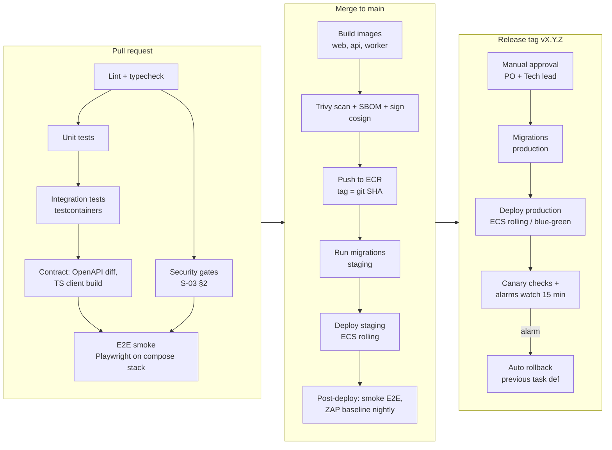

# D-02 CI/CD Pipeline Design

| Field | Value |
|---|---|
| Document ID | D-02 |
| Version | 0.1 |
| Owner | DevOps lead |
| Last updated | 2026-10-23 |
| Related | S-03 security gates, D-01, D-03, D-04, Q-01 |

**Platform:** GitHub + GitHub Actions (assumed; GitLab CI works the same way). AWS access uses OIDC, with no stored keys.

## 1. Pipeline overview

## 2. Workflows

| Workflow file | Trigger | Jobs |
|---|---|---|
| `ci.yml` | `pull_request` | Path-filtered: `backend/**` → ruff, mypy, pytest (unit + integration), Bandit, pip-audit. `frontend/**` → eslint, tsc, vitest, npm audit, Lighthouse CI (budgets N-01 §3). `infra/**` → terraform fmt/validate, tflint, checkov, `terraform plan` (staging) posted as a PR comment. Always: gitleaks, Semgrep, OpenAPI diff, E2E smoke. |
| `build-deploy-staging.yml` | `push` to `main` | Build 3 images (multi-stage, distroless/slim bases) → Trivy → Syft SBOM → cosign sign → push ECR → migrate → deploy → smoke E2E |
| `release.yml` | Tag `v*` | Environment `production` (required reviewers) → retag the staging-verified images (no rebuild) → migrate → deploy → canary watch → rollback on alarm |
| `nightly.yml` | cron 01:00 IST | Full E2E (Chromium, WebKit, mobile), accessibility, visual regression, ZAP baseline on staging, dependency audit |
| `terraform-apply.yml` | Merge to `main` touching `infra/` (staging auto); manual dispatch (production, approval) | `terraform apply` from the plan artifact |
| `db-restore-drill.yml` | Manual / quarterly | Restore the latest snapshot to a temporary instance, run integrity checks and the erasure-ledger replay, then destroy (D-06) |

## 3. Quality and security gates (merge blocking)
- Lint and type checks: ruff + mypy (strict on `app/core`, `rules`, `auth`); eslint + `tsc --noEmit`.
- Tests: unit and integration green; coverage thresholds (Q-01 §3) enforced by `pytest --cov-fail-under`.
- Authorisation matrix green.
- Security gates (S-03 §2).
- OpenAPI breaking-change check: a breaking diff needs a `breaking-change` label and an ADR or version bump.
- Lighthouse CI budgets on key routes.
- Two approvals for changes under CODEOWNERS-protected paths (`backend/app/modules/{auth,rules,audit,privacy}`, `infra/`, `.github/`).

## 4. Build
- Backend image: `python:3.12-slim`, `uv` for dependency install from the lock file, non-root user, `uvicorn` with `--proxy-headers`. The same image is used for the worker with a different command.
- Frontend image: Next.js `output: 'standalone'` on a `node:22-slim` base, non-root. Static assets are uploaded to the S3 static bucket during deploy, so CloudFront serves them.
- Reproducibility: lock files committed (`uv.lock`, `pnpm-lock.yaml`); images tagged with the git SHA; build provenance (SLSA level 2 via GitHub attestations).

## 5. Deployment
- **ECS rolling deployment** with minimum healthy 100% and maximum 200%, and the deployment circuit breaker enabled (auto rollback on failed health checks).
- **Health checks:** `/healthz` (ALB target health); `/readyz` checks DB and Redis before a task receives traffic.
- **Migrations:** a one-off ECS task `alembic upgrade head` runs before the service update. If the migration fails, deployment stops. Migrations must be backward compatible (D-03 §5).
- **Post-deploy canary:** CloudWatch Synthetics journeys plus watching the alarms for 5xx rate > 2%, p95 > 1 s and failed deploy health. If any fires within 15 minutes, the workflow rolls back to the previous task definition.
- **Blue/green** (CodeDeploy) is optional from Phase 2, for zero-risk releases during exam season.

## 6. Rollback
| Situation | Action |
|---|---|
| App bug, schema unchanged or expanded only | Redeploy the previous task definition (one click, `rollback.yml`) |
| Migration added a column or table (expand) | App rollback is safe; leave the schema |
| Destructive migration (contract) | Only released ≥ 1 version after the code stopped using the object, so rollback is never needed |
| Data corruption | Incident process; PITR restore to a new instance and selective repair (D-07) |

## 7. Secrets and permissions in CI
- GitHub OIDC → IAM roles: `ci-readonly-plan` (PRs), `cd-staging` (main), `cd-production` (release environment with required reviewers).
- Fork PRs get no secrets. The E2E smoke uses only local compose with fakes.
- Dependabot PRs run the full CI but cannot deploy.

## 8. Metrics (DORA)
Deployment frequency, lead time, change failure rate and MTTR are collected from GitHub and incident records and reviewed every month (targets in N-01 §10).
