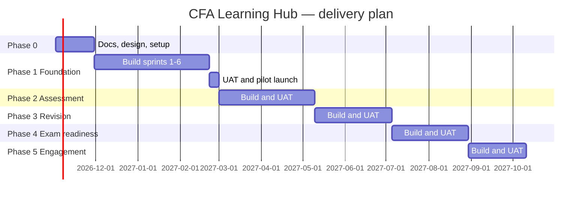

# M-02 Estimates, Timeline & Budget

| Field | Value |
|---|---|
| Document ID | M-02 |
| Version | 0.1 — Draft |
| Owner | Project manager |
| Last updated | 2026-10-23 |
| Related | M-01 Charter, P-10 Roadmap, A-05 Infrastructure |

> These are planning estimates for discussion. Effort is in **person-weeks (pw)**. Money figures are indicative ranges that must be checked against vendor calculators and quotes before the budget is approved.

## 1. Team assumptions

| Role | Allocation | Notes |
|---|---|---|
| Tech lead (full-stack) | 1.0 | Architecture, backend core, code review |
| Full-stack developers | 2.0 | Next.js and FastAPI |
| UX / UI designer | 0.5 | Heavy in Phase 0–1, light later |
| QA engineer | 0.5 | Automation from Phase 1 |
| DevOps / SRE | 0.25 | Heavier in Phase 0 and before go-live |
| Product owner | 0.5 | |
| Project manager | 0.25 | Can be combined with the PO role |
| Academic team | Separate budget | Authors and reviewers produce content in parallel |

Delivery capacity is about **3.0 developer-pw per calendar week**, after meetings and support.

## 2. Effort by phase

### Phase 0 — Set-up (4 weeks)

| Work item | Effort (pw) |
|---|---|
| Phase 0–1 documentation (this set) and review cycles | 4 |
| Design system and key screen designs | 3 |
| Repository, local dev, CI pipeline, staging infrastructure (Terraform) | 3 |
| Seed-data extraction from the prototype | 1 |
| **Total** | **11** |

### Phase 1 — Foundation (13 weeks, including a 1-week holiday buffer)

| Epic | Effort (pw) |
|---|---|
| E1 Authentication (phone OTP, staff email + password with MFA), sessions | 4 |
| E2 Users, roles, batches, enrolments, entitlements (admin UI) | 4 |
| E3 Consent and parental consent, privacy notice, data requests | 3 |
| E4 Catalogue admin: subjects, LMs, topics, LOS | 3 |
| E5 Resources: video (Bunny Stream), PDF and class-note upload, secure playback and viewing | 5 |
| E6 Learning library UI: subject → LM → topic, notes renderer, bookmarks, search | 5 |
| E7 Progress: resource completion, mark learned, revision log, EOC self-entry | 3 |
| E8 Unlock rule engine and admin rule editor | 3 |
| E9 Student dashboard | 2 |
| E10 Audit log and admin reports (basic) | 2 |
| E11 Production infrastructure, observability, backups, security hardening | 3 |
| E12 Testing: automated end-to-end, accessibility, load smoke test; UAT support | 3 |
| **Total** | **40** |

### Later phases (to be re-estimated at each phase gate)

| Phase | Duration | Effort (pw) | Main epics |
|---|---|---|---|
| 2 Assessment | 10 weeks | ~30 | QBank and versioning, review workflow, release validator, test builder, test engine with autosave, reports, exports |
| 3 Revision | 8 weeks | ~22 | Notes and revision-sheet studio, DOCX/PDF export, flashcards, spaced repetition |
| 4 Exam readiness | 8 weeks | ~22 | Mock and Premium Pack tracking, analytics, recommendations |
| 5 Engagement | 6 weeks | ~16 | XP, streaks, badges, contests, leaderboard, certificates |

**Total build effort is about 141 pw** before contingency. Add **20% contingency (~28 pw)**.

## 3. Timeline (proposed)

Sprints are 2 weeks. Each phase ends with UAT (Q-02) and a production release.

**Exam-calendar note:** CFA Level I runs in several windows a year. Avoid releasing in the 3 weeks before a window that most enrolled students are sitting. Freeze dates go in the release calendar (D-03).

## 4. Running-cost model (monthly, indicative)

### 4.1 Cloud infrastructure (AWS Mumbai, see A-05)

| Item | Production | Staging |
|---|---|---|
| Compute: ECS Fargate (web, api, worker; 2 tasks each in prod) | USD 120–200 | USD 40–70 |
| PostgreSQL: RDS, Multi-AZ in prod, ~2 vCPU / 4 GB | USD 130–180 | USD 30–50 |
| Redis: ElastiCache, small | USD 25–50 | USD 15–25 |
| Load balancer, NAT gateway, data transfer | USD 60–120 | USD 40–60 |
| CloudFront CDN and WAF | USD 20–60 | USD 5–10 |
| S3, backups, CloudWatch, Secrets Manager, KMS | USD 30–80 | USD 10–20 |
| **Subtotal** | **USD 385–690** | **USD 140–235** |

The combined total is about **USD 525–925 per month (≈ ₹45,000–80,000)** at pilot scale (up to ~2,000 active students).

### 4.2 Third-party services

| Service | Cost driver | How to estimate |
|---|---|---|
| Video hosting and streaming (Bunny Stream proposed) | GB stored and GB delivered | Monthly delivery GB ≈ active students × hours watched per student × GB per hour (≈ 0.5–0.7 GB/h at 720p). Example: 1,000 students × 15 h × 0.6 GB ≈ 9 TB. Price it with the vendor calculator for the India/Asia region. |
| SMS OTP (DLT-registered provider, e.g. MSG91) | OTPs sent | Students × logins needing OTP per month × per-SMS rate (DLT rates are usually a fraction of a rupee per SMS; get a quote) |
| Transactional email (Amazon SES) | Emails sent | Low; under USD 10/month at pilot scale |
| Error tracking (Sentry, Team plan) | Events | About USD 26–80/month |
| Domain, TLS | | TLS is free with ACM; domain is nominal |
| External penetration test | One-off per major release | Quote needed; budget it before the Phase 1 go-live |
| Legal review (DPDP, terms, licensing) | One-off plus retainer | Quote needed |

## 5. Budget summary template

| Line | Basis | Amount |
|---|---|---|
| Build effort | 141 pw + 20% contingency × blended weekly rate [TBD] | |
| Cloud infrastructure (12 months) | §4.1 | |
| Video hosting (12 months) | §4.2, after the usage estimate | |
| SMS, email and other SaaS (12 months) | §4.2 | |
| Pen test and security review | Quote | |
| Legal and privacy review | Quote | |
| Content production (authors and reviewers) | Academic plan | |
| **Total** | | |

## 6. Assumptions to validate
1. Team availability as in §1 from 2 Nov 2026.
2. Pilot scale of up to 2,000 active students in year 1, and up to 300 users at once during contests (Phase 5).
3. About 200 hours of class video in the first year.
4. Bunny Stream and AWS Mumbai are confirmed in ADR review (A-02).
5. The academic team delivers approved content in step with the phases (risk R-03).
